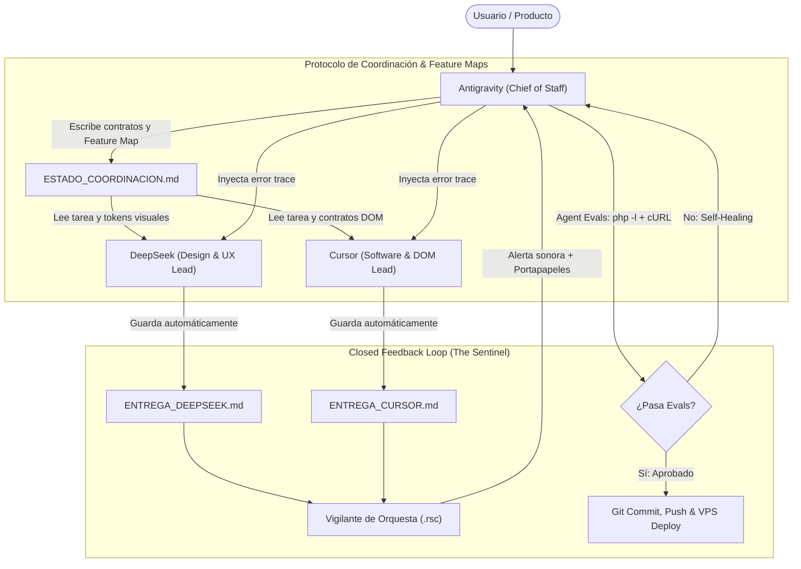

# PROTOCOLO BASE DE ORQUESTACIÓN MULTI-AGENTE (METODOLOGÍA SPACEX)
## Antigravity (Chief of Staff & Release Lead) + DeepSeek (Design & UX Lead) + Cursor (Software & DOM Lead)

> **Plantilla Maestra y Guía Operativa para Nuevos Proyectos**  
> *Inspirada en el modelo de ingeniería autónoma de alto rendimiento de SpaceX (Lauren Tan): diseñada para orquestar agentes en paralelo con Feature Maps, bucles cerrados de auto-reparación y Guardrails arquitectónicos inmutables.*

---

## 1. Filosofía de la Orquesta: De "Asistente Copilot" a "Organización de Ingeniería"

Cuando varios modelos de IA trabajan sobre un repositorio sin una arquitectura estricta:
- Se producen alucinaciones de archivos, rutas y nombres de tablas.
- Un modelo renombra un ID o clase CSS que el otro necesita para funcionar.
- Modelos en la nube intentan ejecutar comandos git o despliegues sin contexto de infraestructura, arrojando errores o desconfigurando el servidor.

Para resolver esto a escala industrial, cada proyecto opera como una **organización de ingeniería autónoma**:
- **Chief of Staff & Release Lead (Antigravity):** Diseña los *Feature Maps*, fija los *Guardrails*, asigna las tareas a los buzones, ejecuta las pruebas de integración (*Agent Evals*), resuelve dependencias complejas y comanda los despliegues.
- **Design & UX/UI Lead (DeepSeek):** Especialista en maquetación visual, diseño responsivo, CSS/Tailwind, accesibilidad WCAG 2.1 AA / DUA y formatos oficiales de impresión.
- **Software & DOM Lead (Cursor):** Especialista en controladores, widgets administrativos, modelos relacionales, consultas optimizadas y manipulación reactiva del DOM.



---

## 2. Los 3 Pilares del Sistema Autónomo SpaceX

### Pilar 1: Feature Maps Quirúrgicos (Cero Alucinación)
Cada tarea o fase se define mediante un mapa estructural que delimita el alcance:
- **Rutas de archivos exactas:** Los agentes solo tocan los archivos explícitamente declarados.
- **Esquema de datos:** Variables que entran y salen con sus nombres y tipos.
- **Contrato inmutable de IDs:** Nombres exactos de botones, inputs y contenedores (`#btnAccion`, `#modalDialog`).

### Pilar 2: Closed Feedback Loops & Auto-Reparación (*Self-Healing*)
1. El agente deposita su código en su respectivo buzón (`ENTREGA_*.md`).
2. Antigravity ejecuta pruebas de evaluación:
   - Sintaxis estricta (`php -l`, compiladores, linters).
   - Respuestas HTTP de endpoints (cURL `200 OK`).
3. **Auto-reparación:** Si se detecta un error o regresión, Antigravity devuelve el log exacto del fallo al buzón del agente. El agente ajusta su solución hasta que todas las pruebas pasen en verde.

### Pilar 3: Guardrails Arquitectónicos Inmutables
- **Guardrail de Git/Deploy:** Prohibición absoluta de `git commit / push` o despliegues a DeepSeek y Cursor.
- **Guardrail de IDs del DOM:** Prohibido renombrar o eliminar IDs del contrato.
- **Guardrail de Resiliencia:** Ninguna vista o endpoint puede arrojar un error 500; todo controlador debe implementar fallbacks seguros (`asegurarDatosDemo()`).

---

## 3. Protocolo de Buzones y Vigilancia Activa (Cero Copiado Manual)

El sistema elimina el copiado y pegado manual entre herramientas mediante el **Vigilante de Orquesta** (`iniciar_vigilante.cmd` / `.rsc/vigilante_orquesta.js`):
1. **Sondeo en segundo plano:** Supervisa cada 10 segundos los buzones.
2. **Estímulo acústico en Windows:** Emite `[System.Media.SystemSounds]::Exclamation`.
3. **Notificación emergente (Toast):** Muestra el avance y la tarea lista.
4. **Auto-copiado al Portapapeles:** Copia automáticamente el mensaje de arranque para que solo debas presionar `Ctrl+V` y `Enter` en la ventana del agente correspondiente.

---

## 4. Prompts de Arranque para Nuevos Proyectos

### Para DeepSeek (Harness / Web):
```text
Actúas como Design & UX/UI Lead de este proyecto bajo la metodología SpaceX.
Tu partitura oficial y Feature Map están en ESTADO_COORDINACION.md y ENTREGA_DEEPSEEK.md.
Solo modificas archivos CSS, maquetación visual y tokens de diseño asignados.
Respeta estrictamente los IDs del DOM acordados. Tienes estrictamente prohibido ejecutar git commit/push o comandos de despliegue.
Guarda tu entrega completa en ENTREGA_DEEPSEEK.md y al terminar ejecuta:
node .rsc/centinela_buzon.js deepseek --intervalo=60 --max-ciclos=0
```

### Para Cursor:
```text
Actúas como Software & DOM Lead de este proyecto bajo la metodología SpaceX.
Tu partitura oficial y Feature Map están en ESTADO_COORDINACION.md y ENTREGA_CURSOR.md.
Solo modificas controladores, widgets, lógica de cliente y conexión backend asignados.
Respeta estrictamente los IDs del DOM y las clases visuales de DeepSeek.
Tienes prohibido hacer commit/push o alterar el despliegue.
Guarda tu entrega completa en ENTREGA_CURSOR.md y al terminar ejecuta:
node .rsc/centinela_buzon.js cursor --intervalo=60 --max-ciclos=0
```

### Para Antigravity (Chief of Staff):
```text
Actúas como Chief of Staff, Arquitecto Backend y Release Lead bajo la metodología SpaceX (Antigravity + DeepSeek + Cursor).
Tus responsabilidades:
1. Diseñar los Feature Maps y contratos de la Ola activa en ESTADO_COORDINACION.md.
2. Construir la lógica backend, APIs y modelos de datos.
3. Ejecutar pruebas automatizadas (Agent Evals) sobre las entregas en los buzones.
4. Si hay fallos, reinyectar el stack trace en el buzón del agente para auto-reparación (Self-Healing).
5. Ser el único agente autorizado para git commit, git push y despliegues a producción.
6. Sellar el cierre de la Ola en CONTROL_CAMBIOS.md.
```
