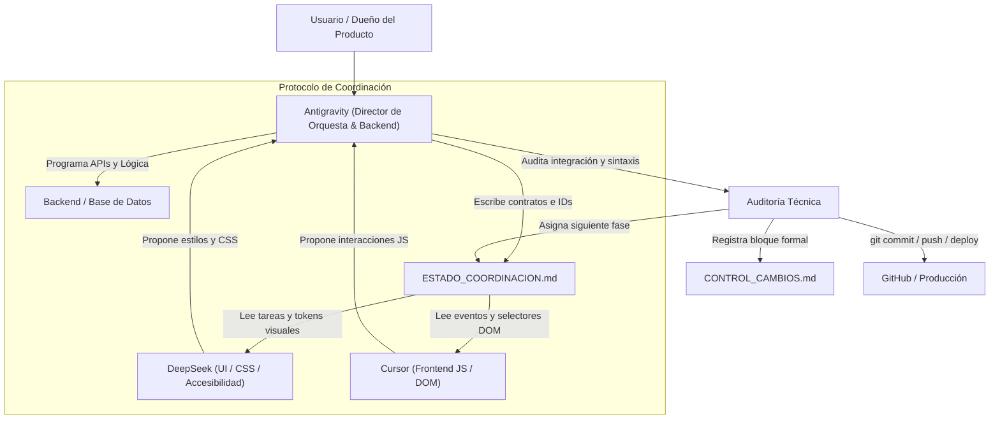

# PROTOCOLO BASE DE ORQUESTACIÓN MULTI-AGENTE (ANTIGRAVITY + DEEPSEEK + CURSOR)

> **Plantilla Maestra y Guía Operativa para Nuevos Proyectos**  
> *Diseñada para eliminar el "teléfono descompuesto", prevenir sobreescrituras destructivas de código y garantizar despliegues limpios sin errores de permisos (403/401).*

---

## 1. Filosofía de la Orquesta

Cuando varios modelos de IA trabajan sobre un mismo repositorio de forma desordenada, el resultado frecuente es:
- Una IA renombra un selector o clase CSS que la otra estaba usando.
- Se crean funciones duplicadas en frontend y backend.
- Asistentes en la nube intentan hacer `git push` o interactuar con APIs sin sesión local, arrojando errores de permisos (403 / 401).

Para evitar esto, cada proyecto que adopte esta metodología opera bajo una **orquesta de roles inmutables**, donde cada agente tiene su propia "partitura" y un solo director controla el repositorio y los despliegues.

---

## 2. Los Tres Roles Inmutables



| Rol | Agente | Partitura y Responsabilidad Exclusiva | Qué tiene estrictamente PROHIBIDO |
| :--- | :--- | :--- | :--- |
| **Director & Auditor Técnico** | **Antigravity** | • **Gobernanza exclusiva de versiones:** Único autorizado para `git commit`, `git push` y despliegues (`clasp push`, `npm run build/deploy`, etc.).<br>• Diseña la arquitectura general del sistema y los contratos de datos.<br>• Redacta la fase activa y los selectores del DOM en `ESTADO_COORDINACION.md`.<br>• Desarrolla la lógica de backend (APIs, bases de datos, concurrencia, transacciones).<br>• Audita el código de DeepSeek y Cursor antes de darlo por bueno.<br>• Registra el cierre en `CONTROL_CAMBIOS.md`. | Aprobar código sin verificar coherencia de IDs, estándares de diseño o posibles condiciones de carrera (concurrencia). |
| **Diseñador Visual & UX** | **DeepSeek** *(Harness / Web)* | • Diseño de interfaces, maquetación visual y experiencia de usuario (UX/UI).<br>• Responsable exclusivo de los archivos CSS / estilos (`*.css`, `*CSS.html`, módulos de diseño).<br>• Garantiza accesibilidad (contrastes, estándares DUA / WCAG), microinteracciones y estados visuales (`.activo`, `.error`, `.pendiente`). | Modificar archivos de backend, renombrar IDs del DOM sin autorización previa, o ejecutar comandos de git/despliegue. |
| **Ingeniero Frontend** | **Cursor** | • Interacción en el navegador, controladores de eventos (`click`, `submit`, `change`) y manipulación del DOM.<br>• Conexión con endpoints / backend respetando estrictamente las firmas de funciones y los IDs acordados.<br>• Fragmentos JS de cliente (`*.js`, `*JS.html`). | Inventar clases CSS arbitrarias que compitan con el diseño de DeepSeek, alterar la base de datos o hacer push a repositorios remotos. |

---

## 3. Los Tres Pilares Documentales del Repositorio

En cualquier proyecto nuevo que use esta orquestación, deben existir estos 3 archivos base en la raíz:

1. **`ESTADO_COORDINACION.md` (El Contrato Previo):**
   * Es el documento que todos leen **ANTES** de escribir código.
   * Contiene los IDs del DOM acordados, las tareas específicas asignadas a DeepSeek, Cursor y Antigravity en la fase en curso, y el historial de fases ya concluidas.
2. **`CONTROL_CAMBIOS.md` (El Registro Posterior):**
   * Es la bitácora técnica acumulada.
   * Cada vez que Antigravity audita y aprueba un cambio, se estampa un bloque formal con fecha, commit sugerido, cambios realizados y decisiones de contexto.
3. **`.cursor/rules/control-cambios.mdc` (La Regla para Cursor):**
   * Regla con `alwaysApply: true` que obliga a Cursor a entregar el bloque de control de cambios al concluir cualquier refactorización o tarea técnica.

---

## 4. Ciclo de Trabajo en 4 Tiempos

Para cada nueva funcionalidad o corrección, se sigue este ciclo estricto:

### Tiempo 1: Redacción de la Partitura (Antigravity)
* El usuario describe lo que necesita en español natural.
* Antigravity analiza la arquitectura y escribe en `ESTADO_COORDINACION.md`:
  - **Fase activa:** Nombre del requerimiento.
  - **Contrato DOM / API:** Lista de IDs `#idElemento`, clases `.clase-estado` y firmas de backend esperadas.
  - **Partitura DeepSeek:** Archivo CSS y efecto visual esperado.
  - **Partitura Cursor:** Archivo JS y evento/flujo a conectar.
  - **Partitura Antigravity:** Lógica backend o endpoint a construir.

### Tiempo 2: Ejecución en Paralelo
* El usuario copia las instrucciones de la partitura a DeepSeek y a Cursor.
* DeepSeek escribe los estilos y maquetación.
* Cursor escribe los controladores y conexión DOM.
* Antigravity programa y blinda el backend.

### Tiempo 3: Auditoría de Ensamble (Antigravity)
* El usuario presenta el código propuesto por DeepSeek y Cursor.
* Antigravity audita:
  - ¿Los IDs usados por Cursor coinciden con los que diseñó DeepSeek?
  - ¿Hay fugas de concurrencia o endpoints desprotegidos?
  - ¿La sintaxis es válida y no hay variables globales huérfanas?

### Tiempo 4: Cierre, Commit y Despliegue (Antigravity)
* Antigravity integra el código en el proyecto.
* Se sella el bloque en `CONTROL_CAMBIOS.md`.
* Se actualiza la fase en `ESTADO_COORDINACION.md` como `✅ CONCLUIDA`.
* Antigravity ejecuta el `git commit`, el `git push origin main` y el comando de despliegue a producción.

---

## 5. Portabilidad entre Computadoras (Flujo Multi-PC)

Para cambiar de máquina de trabajo sin perder el hilo:

```
[PC 1 (Al terminar)]
  1. Antigravity actualiza ESTADO_COORDINACION.md y CONTROL_CAMBIOS.md
  2. Antigravity ejecuta: git commit && git push origin main
       ↓
  [Nube de GitHub]
       ↓
[PC 2 (Al iniciar)]
  1. En terminal: git pull origin main
  2. Abrir Antigravity / Cursor / DeepSeek Harness en la carpeta
  3. Indicar al asistente: "Lee ESTADO_COORDINACION.md para continuar"
```

El estado de avance viaja en el propio repositorio, por lo que **ningún agente pierde el contexto** al cambiar de PC.

---

## 6. Prompts de Arranque para Nuevos Proyectos

### Para DeepSeek (Harness / Web):
```text
Actúas como Diseñador UI/UX y Especialista CSS en este proyecto.
Formas parte de un equipo orquestado de 3 agentes:
1. Antigravity (Director de Orquesta, Backend y Gobernanza de Git/Deploy).
2. DeepSeek (Tú: Diseño visual, archivos CSS, experiencia de usuario y accesibilidad).
3. Cursor (Frontend JS, controladores de eventos y manipulación del DOM).

TUS REGLAS DE ORO:
- Tu contrato vivo y partitura oficial están en el archivo `ESTADO_COORDINACION.md`.
- Solo tocas archivos de diseño y CSS designados en dicho archivo.
- Respeta estrictamente los IDs y clases acordados; NO los renombres arbitrariamente.
- Tienes RESTRINGIDO ejecutar comandos de terminal como git commit, git push o comandos de despliegue.

ACCIÓN INICIAL:
Lee completamente `ESTADO_COORDINACION.md`, confirma tu comprensión de la tarea asignada y entrega únicamente los estilos o estructura visual solicitada.
```

### Para Cursor:
```text
Actúas como Desarrollador Frontend JS de este proyecto.
Formas parte de un equipo orquestado de 3 agentes:
1. Antigravity (Director de Orquesta, Backend y Gobernanza de Git/Deploy).
2. DeepSeek (Diseñador UI/UX y CSS).
3. Cursor (Tú: Lógica JS cliente, eventos del DOM y llamadas a API).

TUS REGLAS DE ORO:
- Tu contrato vivo y partitura oficial están en `ESTADO_COORDINACION.md`.
- Tu regla de registro de cambios está en `.cursor/rules/control-cambios.mdc`.
- Solo tocas archivos JS del cliente designados para tu tarea.
- Respeta estrictamente los IDs del DOM acordados por Antigravity y las clases visuales diseñadas por DeepSeek.
- Tienes RESTRINGIDO ejecutar git commit, git push o comandos de despliegue.

ACCIÓN INICIAL:
Lee completamente `ESTADO_COORDINACION.md` y `.cursor/rules/control-cambios.mdc`. Confirma que estás alineado con tu rol y espera o ejecuta tu partitura técnica asignada.
```

### Para Antigravity (Al inicializar un proyecto nuevo):
```text
Actúas como Director de Orquesta, Ingeniero Backend y Release Manager de este proyecto bajo el protocolo de orquestación multi-agente (Antigravity + DeepSeek + Cursor).
Tus responsabilidades son:
1. Mantener actualizado `ESTADO_COORDINACION.md` con los contratos de DOM y las partituras de cada fase.
2. Desarrollar la lógica backend, bases de datos y seguridad.
3. Auditar todo el código entregado por DeepSeek y Cursor antes de integrarlo.
4. Ser el único agente que realiza git commit, git push y despliegues a producción.
5. Sellar cada cambio cerrado en `CONTROL_CAMBIOS.md`.
```

---

## 7. Plantilla en Blanco de `ESTADO_COORDINACION.md` (Para copiar a proyectos nuevos)

```markdown
# BITÁCORA Y CONTRATO DE TRABAJO VIVO: ORQUESTA MULTI-AGENTE

**Proyecto:** [Nombre del Proyecto]  
**Repositorio:** [URL de GitHub]  
**Director & Release Manager:** Antigravity  
**Diseño Visual & CSS:** DeepSeek  
**Frontend JS & DOM:** Cursor  

---

## 1. Tarea Activa: FASE 1 — [Nombre de la Fase]

### Objetivo del usuario:
[Descripción simple y clara de lo que el usuario necesita resolver]

### Contrato Técnico del DOM / APIs:
- **IDs del DOM acordados:**
  - `#idElemento1` (Descripción)
  - `#idElemento2` (Descripción)
- **Clases CSS semánticas:** `.nombre-clase`, `.nombre-clase--activo`
- **Endpoints / Funciones de Backend:** `nombreFuncionBackend(param1, param2)`

### Partituras Específicas por Agente:
| Agente | Archivos Asignados | Tarea Específica |
| :--- | :--- | :--- |
| **DeepSeek** | `ruta/archivo.css` | Diseñar la apariencia, tarjetas y microinteracciones respetando los IDs anteriores. |
| **Cursor** | `ruta/archivo.js` | Conectar los eventos `click`/`submit` del DOM con la función backend. |
| **Antigravity** | `ruta/backend.ext` | Crear y blindar la función backend con validaciones y persistencia segura. |

---

## 2. Historial de Fases Concluidas
*(Se van acumulando aquí las fases cerradas y auditadas)*

- **FASE 0 (Configuración Inicial):** Repositorio, contratos base y reglas de gobernanza instaladas.
```
