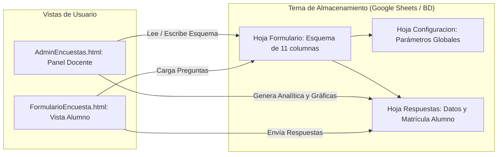
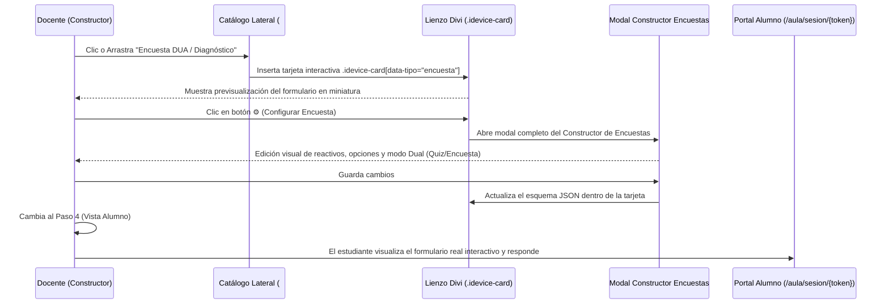

# Radiografía Arquitectónica: Constructor de Encuestas y Quizzes (AppsScript)
**Referencia Canónica:** `AdminEncuestas.html`, `Encuestas.gs`, `FormularioEncuesta.html`, `ENTREGA_CONSTRUCTOR_DUAL_ENCUESTA_QUIZ_BUILD_570.md`  
**Objetivo de Integración:** Menú y Lienzo del Constructor de Clase Laravel (`https://timbres.online/aula/constructor/1?paso=3`)  
**Fecha de Auditoría:** 26 de Noviembre de 2026  
**Responsable:** Antigravity (Chief of Staff & Release Lead)

---

## 1. Resumen Ejecutivo y Enlace de Descarga del Paquete

Para el análisis técnico forense del constructor de encuestas original de AppsScript, se ha consolidado el paquete descargable con todos los archivos fuente, controladores y estilos:

| Archivo ZIP | Tamaño | URL de Descarga en Vivo | Ruta Local en Disco |
| :--- | :---: | :--- | :--- |
| **`constructor_encuestas_appsscript.zip`** | ~93 KB | [Descargar ZIP Constructor Encuestas](https://timbres.online/descargas/constructor_encuestas_appsscript.zip) | `g:\Mi unidad\PROYECTOS\Academia\public\descargas\constructor_encuestas_appsscript.zip`<br>`g:\Mi unidad\PROYECTOS\Lectura\descargas\constructor_encuestas_appsscript.zip` |

### Archivos incluidos en el paquete:
1. `AdminEncuestas.html`: Interfaz del constructor visual, pestañas ribbon, modales de preguntas y gráficas.
2. `AdminEncuestasCSS.html`: Sistema completo de tokens de diseño, modales, grillas y diseño móvil.
3. `FormularioEncuesta.html`: Vista pública accesible donde el alumno o padre responde la encuesta/quiz.
4. `FormularioEncuestaCSS.html`: Estilos optimizados de respuesta, tarjetas de reactivo y feedback.
5. `Encuestas.gs`: Backend completo en Google Apps Script (validación de esquema, persistencia, roles analíticos, lógica condicional y exportación).
6. `16_EncuestasDemo.gs`: Sembrador y dataset de ejemplo de movilidad escolar y diagnóstico.
7. `ENTREGA_CONSTRUCTOR_ENCUESTAS_BUILD_569.md`: Documento de diseño original para el constructor de clases.
8. `ENTREGA_CONSTRUCTOR_DUAL_ENCUESTA_QUIZ_BUILD_570.md`: Especificación de la evolución dual (Encuesta no calificada vs Quiz calificable con retroalimentación).
9. `constructor/Formulario.html`: Formulario base del subsistema eXeLearning.

---

## 2. Anatomía del Motor de Encuestas en AppsScript

El sistema de encuestas de AppsScript opera sobre una **terna de hojas de cálculo normalizadas**:



### A. Esquema de 11 Columnas de la Hoja `Formulario`
El archivo `Encuestas.gs` (líneas 319-347) procesa exactamente 11 columnas por cada pregunta:

| Col | Campo | Tipo | Función Arquitectónica |
| :---: | :--- | :---: | :--- |
| **1** | `id` | String | Slug único generado automáticamente por `idDesdeTexto(etiqueta)` (ej. `transporte_principal`). |
| **2** | `tipo` | Enum | Tipo de reactivo: `texto`, `parrafo`, `unica`, `multiple`, `numero`, `fecha`, `sino`, `escala`, `archivo`. |
| **3** | `etiqueta` | String | Enunciado formal o pregunta formulada al estudiante. |
| **4** | `ayuda` | String | Texto secundario con instrucciones o aclaraciones metodológicas. |
| **5** | `placeholder` | String | Texto de sugerencia dentro del campo de entrada. |
| **6** | `obligatoria` | Boolean | `TRUE` o `FALSE`. |
| **7** | `opciones` | JSON Array | Lista de opciones para opción única, múltiple o escalas `["Autobús", "A pie", "Bicicleta"]`. |
| **8** | `orden` | Number | Posición secuencial en el formulario (1, 2, 3...). |
| **9** | `activa` | Boolean | Permite ocultar/archivar preguntas sin romper el histórico de respuestas existente. |
| **10** | `columna` | Number | Índice de la columna asignada en la hoja `Respuestas`. |
| **11** | `extra` | JSON Object | Metadatos avanzados: roles analíticos, reglas condicionales y evaluación formativa. |

### B. El Objeto `extra` (La Clave de la Potencia Analítica)
La columna 11 `extra` alberga la configuración especializada:

```json
{
  "rol": "dimension",
  "graficable": true,
  "esDimension": true,
  "padre": "turno_escolar",
  "opcionesPorPadre": {
    "Matutino": ["1A", "1B", "1C", "1D"],
    "Vespertino": ["1F", "1G", "2F", "2G"]
  },
  "condicion": {
    "activa": true,
    "pregunta": "medio_transporte",
    "operador": "igual",
    "valor": "Bicicleta"
  },
  "esQuiz": true,
  "puntos": 2,
  "respuestaCorrecta": "Bicicleta",
  "retroalimentacion": "Excelente elección ecológica y saludable."
}
```

1. **Roles Analíticos (`ROLES_ANALITICOS`):**
   - `identidad`: Datos informativos (nombre, matrícula, folio, texto libre). Nunca se grafican.
   - `dimension`: Criterios de segmentación (Eje X en gráficas). Permiten filtrar y agrupar respuestas (ej. Turno, Grado, Grupo, Género).
   - `metrica`: Evaluaciones cuantitativas o cualitativas (Eje Y). Se grafican como conteo, porcentaje o promedio.
2. **Jerarquía Condicional de Respuestas:**
   - Si la dimensión `grupo` depende de la dimensión `turno`, el campo `opcionesPorPadre` filtra automáticamente los grupos en cascada al cambiar el turno.
3. **Reglas Condicionales:**
   - La pregunta solo se despliega en pantalla si se cumple la condición: `igual`, `distinto`, `contiene`, `vacio`, `no_vacio`.
4. **Modo Dual Quiz (Build-570):**
   - Convierte una encuesta común en un **examen o quiz autoevaluable**:
   - Cada reactivo declara `puntos`, `respuestaCorrecta` y `retroalimentacion`.
   - `calificarQuizAlumnoST90()` califica al vuelo, calcula porcentaje sobre 10 y guarda en el expediente.

---

## 3. Experiencia de Usuario en AppsScript (`AdminEncuestas.html`)

El constructor se organiza en un **Ribbon Contextual de 3 Vistas**:

```
+---------------------------------------------------------------------------------------+
|  [ 📊 Gráficas ]    [ 📑 Hoja de Datos ]    [ ✏️ Editor de Preguntas ]                |
+---------------------------------------------------------------------------------------+
|                                                                                       |
|  SUBPESTAÑAS DEL EDITOR:                                                              |
|  1. 🌐 Origen de Datos (Vincular Google Sheet / Base de datos)                       |
|  2. 🏷️ Cabecera Institucional (Escuela, Título, Instrucciones, Textos de Éxito)       |
|  3. 📋 Esquema de Preguntas (Listado Drag & Drop, Categorías y Botón "+ Pregunta")    |
|                                                                                       |
|  MODALES ASOCIADOS:                                                                   |
|  • #modalPregunta: Configuración completa de 1 pregunta (tipo, rol, opciones, regla). |
|  • #modalVistaPreviaEncuesta: Enlace público, simulación en vivo y código QR.         |
|  • #modalCategorias: Organización jerárquica de reactivos.                            |
|  • #modalGrafica: Renderizado ampliado interactivo con Chart.js y Apache ECharts.     |
+---------------------------------------------------------------------------------------+
```

---

## 4. Estrategia Quirúrgica de Integración en el Constructor de Clase Laravel

Actualmente, el constructor de clase en `https://timbres.online/aula/constructor/1?paso=3` tiene una ficha en el catálogo lateral denominada `Encuesta DUA`, pero al insertarla sólo genera una tarjeta estática básica.

A continuación se detalla la hoja de ruta para su integración nativa completa:



### A. Paso 1: Enriquecer el Catálogo Lateral (`#panelCatalogoContenidos`)
En `resources/views/aula/constructor.blade.php`, dentro del acordeón `Evaluación y Seguimiento`:
- Sustituir la tarjeta plana por la tarjeta con selector de acción:
  - **Botón Directo:** Arrastrar una encuesta rápida en blanco.
  - **Acción con Menú Popover:**
    1. *Nueva Encuesta en Blanco*: Diseñar desde cero con el constructor.
    2. *Vincular del Banco Institucional ST90*: Censo de Movilidad, Diagnóstico DUA, Encuesta Socioemocional (importa el esquema automáticamente de `16_EncuestasDemo.gs`).

### B. Paso 2: La Tarjeta en el Lienzo (`.idevice-card[data-tipo="encuesta"]`)
Al insertarse en una columna Divi, la tarjeta debe contener:
- **Cabecera con Toolbar Especializada:**
  - Badge: `ENCUESTA / DIAGNÓSTICO` o `QUIZ EVALUABLE`.
  - Iconos de control:
    - `✥`: Arrastrar y mover dentro del lienzo.
    - `⚙️`: Abrir el **Constructor de Preguntas** (`#modalConstructorEncuestasST90`).
    - `📊`: Ver respuestas y gráficas en vivo generadas por el grupo.
    - `🗑️`: Eliminar módulo.
- **Cuerpo de la Tarjeta:**
  - Renderizado reactivo de las primeras preguntas en modo miniatura, con inputs simulados y badges de tipo (`Opción única`, `Escala 1-5`, `Texto`).

### C. Paso 3: El Modal del Constructor (`#modalConstructorEncuestasST90`)
Adaptar la interfaz de `AdminEncuestas.html` dentro de un modal amplio de Laravel:
- Soporte para los 9 tipos de preguntas.
- Selector de modo: **Encuesta Formativa** (sin nota) vs **Quiz Calificable** (con puntos y clave de respuesta).
- Configuración de preguntas condicionales y jerarquías.
- Persistencia: Al pulsar "Guardar", se serializa el array `preguntas` en el JSON de la tarjeta y se envía al endpoint `/api/aula/sesion/{id}/guardar`.

### D. Paso 4: Portal del Estudiante (`portal-alumno.blade.php` y `aula-alumno.js`)
- Cuando el estudiante entra con su código (ej. `NEM-90A`), el módulo de encuesta se renderiza con el motor visual de `FormularioEncuesta.html`:
  - Si es encuesta: Recaba datos y los registra en la base de datos vinculados al `alumno_id` o matrícula.
  - Si es quiz: Calcula la calificación instantánea, muestra la retroalimentación configurada y reporta el puntaje al libro de calificaciones de la sesión.

---

## 5. Esquema de Base de Datos Recomendado en Laravel

Para almacenar las encuestas de manera estructurada en Laravel (compatible tanto con sesiones de clase como independientes), se sugiere la siguiente migración:

```php
// Migración: create_encuestas_table.php
Schema::create('encuestas', function (Blueprint $table) {
    $table->id();
    $table->foreignId('sesion_clase_id')->nullable()->constrained('sesiones_clase')->nullOnDelete();
    $table->string('titulo');
    $table->string('subtitulo')->nullable();
    $table->string('tipo')->default('encuesta'); // 'encuesta' o 'quiz'
    $table->json('configuracion')->nullable();   // puntos, intentos, temporizador
    $table->json('esquema_preguntas');           // Array de preguntas con las 11 propiedades
    $table->boolean('activa')->default(true);
    $table->timestamps();
});

// Migración: create_encuesta_respuestas_table.php
Schema::create('encuesta_respuestas', function (Blueprint $table) {
    $table->id();
    $table->foreignId('encuesta_id')->constrained('encuestas')->cascadeOnDelete();
    $table->foreignId('alumno_id')->nullable()->constrained('alumnos')->nullOnDelete();
    $table->string('matricula')->nullable();
    $table->json('respuestas');                  // Objeto { pregunta_id: respuesta }
    $table->decimal('calificacion', 5, 2)->nullable();
    $table->timestamps();
});
```

---

## 6. Próxima Fase de Implementación
1. **Revisión del archivo ZIP descargado:** Analizar el modal `#modalPregunta` en `AdminEncuestas.html` (línea 665).
2. **Creación del Componente Blade en Laravel:** Portar el formulario de edición de preguntas hacia un modal Blade reusable en `resources/views/aula/partials/modal-constructor-encuestas.blade.php`.
3. **Conexión con el Menú del Constructor:** Enlazar el botón `⚙️` de la tarjeta `.idevice-card[data-tipo="encuesta"]` para invocar este modal y guardar el esquema reactivamente.
