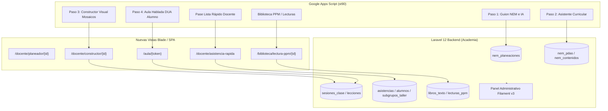
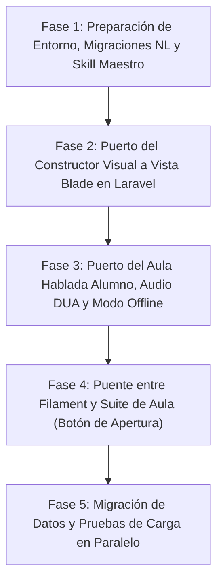

# 📜 DOCUMENTO RECTOR Y CONTRATO DE REQUISITOS DEL SISTEMA (RSC)
## Fusión Arquitectónica: Google Apps Script (st90) ➔ Laravel 12 + Filament (Academia)
**Institución:** Escuela Secundaria Técnica Núm. 90  
**Entidad Federativa:** Nuevo León, México (Región 1 a 13 / UIENL / SENL)  
**Versión:** 2.0.0 — Contrato Maestro Institucional y Normativo  
**Fecha de Emisión:** Noviembre 2026  
**Estado:** `🟢 VIGENTE / CONTRATO ACTIVO INMUTABLE`

---

## 1. Declaración de Misión y Alcance

Este documento constituye el **Contrato Inmutable de Arquitectura, Especificación de Requisitos (RSC) y Decisiones Arquitectónicas (ADR)** para la migración y fusión integral de:
1. **La Suite Pedagógica Interactiva de Aula (Proyecto Actual `st90` en Google Apps Script):** Constructor visual de 4 momentos pedagógicos eXeLearning/Divi, sintetizador oral DUA, motor de mosaicos dinámicos al 100%, quizzes formativos, medición de comprensión lectora (PPM) y asistencia rápida docente.
2. **El Sistema Institucional Integral (`secutec90/Academia` en Laravel 12 + Filament v3):** Base de datos relacional MySQL (113 modelos, 204 migraciones), motor de horarios SIBCA con solver matemático, bitácora escolar de incidencias con firmas digitales, mediación escolar, expediente de alumnos y control de acceso con reloj ESP32 Atomix.
3. **El Marco Normativo y Operativo de Nuevo León:** Cumplimiento estricto con la Ley de Educación de Nuevo León 2026, la Guía Operativa de la UIENL, el Acuerdo 97 (estructura orgánica de secundarias técnicas) y las Normas de Evaluación del Acuerdo 10/09/23.
4. **La Especificación Técnica ARCHITEX OS:** Reglas psicométricas de lectura, resiliencia offline con `localStorage` y accesibilidad inclusiva nativa WCAG 2.1 AA.

> [!IMPORTANT]
> **Regla Cero de la Fusión:** Ningún módulo funcional ya consolidado en producción en el Google Site actual será descartado ni degradado. El objetivo es eliminar la lentitud y los límites de Google Sheets/GAS montando toda la experiencia pedagógica sobre la potencia de Laravel y MySQL.

---

## 2. Marco Normativo y Operativo Específico de Nuevo León (UIENL / SENL)

### A. Catálogo de Sostenimiento y Claves de Centro de Trabajo (CCT)
- La plataforma debe contemplar soporte multi-plantel para:
  - **Federal Transferido:** Claves tipo `19DST...` (administradas operativamente bajo la Unidad de Integración Educativa de Nuevo León - UIENL).
  - **Estatal:** Claves tipo `19EST...` (administradas directamente por la Secretaría de Educación de Nuevo León - SENL).
- Registro obligatorio de:
  - **Región Educativa:** Regiones 1 a 13 de Nuevo León.
  - **Zona Escolar:** Número de zona técnica correspondiente.
  - **Turnos:** Matutino y Vespertino compartiendo talleres físicos e inventarios.

### B. Estructura Orgánica y Subgrupos de Taller Técnico (Acuerdo Secretarial 97)
- En secundarias técnicas rige la carga de **35 periodos lectivos semanales**, con un mínimo de **8 periodos lectivos destinados al Énfasis Tecnológico (Taller)**.
- **Contrato de Subgrupos:** Los alumnos pertenecen a un **grupo académico base** (ej. 1°A con 40 alumnos), pero durante las 8 horas de taller se dividen y recombinan en **subgrupos de taller tecnológico** (ej. *Diseño y Mecánica Automotriz*, *Informática*, *Diseño de Circuitos Eléctricos*). El sistema de horarios SIBCA, las listas de asistencia y las evaluaciones deben gestionar esta dualidad Grupo Base vs Subgrupo Taller.

### C. Evaluación Oficial y Acreditación (Acuerdo 10/09/23 y DGAIR)
- **3 Periodos de Evaluación:** Noviembre (Periodo 1), Marzo (Periodo 2), Julio (Periodo 3).
- **Escala de Calificación:** Entera de 5 a 10. Calificación mínima aprobatoria: **6**.
- **Promoción:** Repetición de grado cuando el alumno acumula 5 o más disciplinas reprobadas.

### D. Inclusión Educativa y Expediente UDEI (Ley de Educación NL 2026)
- Identificación en el expediente del alumno de:
  - Barreras para el Aprendizaje y la Participación (**BAP**).
  - Atención activa por equipo **UDEI** (Unidad de Educación Inclusiva).
  - Registro de adecuaciones curriculares y ajustes razonables DUA vinculados a las planeaciones docentes.

---

## 3. Especificación Pedagógica y Técnica ARCHITEX OS

Basado en las decisiones de diseño registradas en el anteproyecto canónico de ARCHITEX OS:

### A. Métrica de Comprensión Lectora (PPM)
$$\text{PPM} = \frac{\text{Total de Palabras}}{\text{Segundos de Lectura} / 60}$$
- **Aislamiento Psicométrico:** El cronómetro inicia únicamente al pulsar `"Comenzar lectura"` y se congela al pulsar `"Finalizar lectura"`. El cuestionario posterior de 3 preguntas corre en un reloj separado y **NO afecta** la métrica de palabras por minuto.
- **Sin pausa durante lectura:** Si el alumno interrumpe la lectura, reinicia la prueba.

### B. Accesibilidad Universal WCAG 2.1 AA (Inclusión Real para Invidentes)
- Integración de **Web Speech API nativa** en el navegador (client-side, sin dependencias de plugins externos).
- **Atajos de Teclado Universales:**
  - **Barra Espaciadora:** Alterna reproducción / pausa del sintetizador de voz en la clase o lectura.
  - **Teclas `1`, `2`, `3`:** Seleccionan las opciones del cuestionario formativo sin necesidad de ratón.
- Atributos `aria-live="polite"` y gestión estricta del foco del teclado.

### C. Resiliencia Offline (Para Aulas de Medios con Red Inestable)
- Si la conexión a internet se interrumpe durante una lectura o quiz:
  1. El cronómetro local en JavaScript continúa sin alteración.
  2. Las respuestas del alumno se guardan localmente en `localStorage`.
  3. En cuanto el navegador detecta el evento `window.addEventListener('online')`, se ejecuta una sincronización automática en segundo plano hacia `/api/aula/sesion/...`.

---

## 4. Contratos Inmutables del Sistema (Reglas de Oro)

1. **Contrato de Autonomía de Vista de Aula:**
   - La pantalla interactiva del aula (`/aula/{sesion}`) y el constructor (`/docente/constructor/{id}`) funcionan con carga ultrarrápida mediante Fetch API asíncrona hacia los endpoints de Laravel.
2. **Contrato de Fidelidad Visual (Zero Visual Regression):**
   - El constructor de clases conserva al 100% los algoritmos afinados: anchos adaptables (40% a 100%), cuadrículas flexibles (1 a 4 columnas y mosaicos asimétricos), tarjetas limpias sin cabeceras genéricas obligatorias y opciones tipográficas.
3. **Contrato de Persistencia Estructurada (JSON + Relacional):**
   - El estado completo del lienzo pedagógico se almacena como JSON nativo (`json` en MySQL) dentro de la entidad `sesiones_clase`, mientras que los metadatos curriculares (PDA, Contenido NEM, Asignatura, Docente, Grupo, Taller) se almacenan normalizados para reportes oficiales.
4. **Contrato de No Afectación al Módulo SIBCA ni Bitácora:**
   - Los módulos ya concluidos en `Academia` (motor de horarios SIBCA, actas de hechos, mediación escolar, prefectura) permanecen intactos en su lógica interna; únicamente se conectan mediante claves foráneas.
5. **Contrato de Doble Operación (Red de Seguridad):**
   - El sistema actual en Google Apps Script continuará operativo y desplegado en sus 6 endpoints hasta que la suite en Laravel pase satisfactoriamente la fase de pruebas de homologación.

---

## 5. Matriz de Fusión y Traslado de Módulos



---

## 6. Esquema de Base de Datos y Nuevas Migraciones

### 1. Entidad `planteles` (Sostenimiento Nuevo León)
```sql
CREATE TABLE planteles (
    id BIGINT UNSIGNED AUTO_INCREMENT PRIMARY KEY,
    cct VARCHAR(10) NOT NULL UNIQUE,
    sostenimiento ENUM('federal_transferido', 'estatal') NOT NULL,
    region_educativa TINYINT UNSIGNED NOT NULL,
    zona_escolar SMALLINT UNSIGNED NOT NULL,
    nombre_oficial VARCHAR(150) NOT NULL,
    turno ENUM('matutino', 'vespertino', 'mixto') NOT NULL,
    domicilio VARCHAR(255) NULL,
    municipio VARCHAR(100) NOT NULL DEFAULT 'Monterrey',
    telefono VARCHAR(20) NULL,
    created_at TIMESTAMP NULL,
    updated_at TIMESTAMP NULL
);
```

### 2. Entidades de Talleres Tecnológicos (Subgrupos de 8 Horas)
```sql
CREATE TABLE talleres_tecnologicos (
    id BIGINT UNSIGNED AUTO_INCREMENT PRIMARY KEY,
    plantel_id BIGINT UNSIGNED NOT NULL,
    campo_tecnologico ENUM('tecnologias_informacion', 'diseno_manufactura', 'construccion', 'biologicas_salud') NOT NULL,
    nombre_taller VARCHAR(100) NOT NULL,
    aula_taller_fisica VARCHAR(50) NULL,
    cupo_maximo TINYINT UNSIGNED DEFAULT 35,
    FOREIGN KEY (plantel_id) REFERENCES planteles(id)
);

CREATE TABLE subgrupos_taller (
    id BIGINT UNSIGNED AUTO_INCREMENT PRIMARY KEY,
    taller_tecnologico_id BIGINT UNSIGNED NOT NULL,
    ciclo_escolar_id BIGINT UNSIGNED NOT NULL,
    grado TINYINT UNSIGNED NOT NULL,
    turno ENUM('matutino', 'vespertino') NOT NULL,
    maestro_taller_id BIGINT UNSIGNED NOT NULL,
    FOREIGN KEY (taller_tecnologico_id) REFERENCES talleres_tecnologicos(id),
    FOREIGN KEY (maestro_taller_id) REFERENCES maestros(id)
);

CREATE TABLE alumno_taller (
    id BIGINT UNSIGNED AUTO_INCREMENT PRIMARY KEY,
    alumno_id BIGINT UNSIGNED NOT NULL,
    subgrupo_taller_id BIGINT UNSIGNED NOT NULL,
    FOREIGN KEY (alumno_id) REFERENCES alumnos(id),
    FOREIGN KEY (subgrupo_taller_id) REFERENCES subgrupos_taller(id)
);
```

### 3. Ampliación de `sesiones_clase` (Lienzo Visual y Acceso Rápido)
```sql
ALTER TABLE sesiones_clase ADD COLUMN IF NOT EXISTS lienzo_json LONGTEXT NULL COMMENT 'Estructura JSON de filas, mosaicos y módulos del Constructor';
ALTER TABLE sesiones_clase ADD COLUMN IF NOT EXISTS config_visual_json JSON NULL COMMENT 'Preferencias de ancho, tipografía global y cabeceras';
ALTER TABLE sesiones_clase ADD COLUMN IF NOT EXISTS token_acceso VARCHAR(64) UNIQUE NULL COMMENT 'Código o token de entrada rápida para alumnos';
ALTER TABLE sesiones_clase ADD COLUMN IF NOT EXISTS estado_sesion ENUM('borrador', 'publicada', 'en_vivo', 'finalizada') DEFAULT 'borrador';
```

### 4. Evaluaciones Trimestrales Oficiales (Acuerdo 10/09/23)
```sql
CREATE TABLE evaluaciones_trimestrales (
    id BIGINT UNSIGNED AUTO_INCREMENT PRIMARY KEY,
    alumno_id BIGINT UNSIGNED NOT NULL,
    asignatura_id BIGINT UNSIGNED NOT NULL,
    ciclo_escolar_id BIGINT UNSIGNED NOT NULL,
    periodo TINYINT UNSIGNED NOT NULL COMMENT '1: Noviembre, 2: Marzo, 3: Julio',
    calificacion_entera TINYINT UNSIGNED NOT NULL COMMENT 'Escala entera 5 a 10 (mínima aprobatoria 6)',
    inasistencias_periodo TINYINT UNSIGNED DEFAULT 0,
    observaciones TEXT NULL,
    CONSTRAINT chk_calif_sep CHECK (calificacion_entera BETWEEN 5 AND 10),
    FOREIGN KEY (alumno_id) REFERENCES alumnos(id),
    FOREIGN KEY (asignatura_id) REFERENCES asignaturas(id)
);
```

---

## 7. Plan de Ejecución Progresiva en 5 Fases



---

## 8. Criterios de Aceptación y Firma de Conformidad

Para dar por concluida cada fase, se debe validar:
- [ ] Cero errores de sintaxis o ejecución en consola de navegador y logs de Laravel (`storage/logs/laravel.log`).
- [ ] Conservación íntegra de todos los estilos visuales (mosaicos asimétricos, anchos ajustables y tarjetas limpias).
- [ ] Compatibilidad total con los datos existentes en el panel administrativo de `Academia`.
- [ ] Sincronización offline garantizada en el laboratorio de cómputo ante cortes de red.
- [ ] Disponibilidad ininterrumpida del sistema actual mientras se ejecuta la migración.
